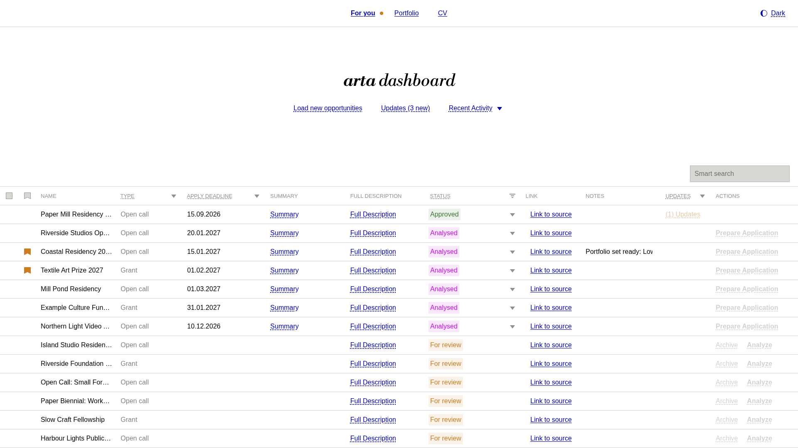
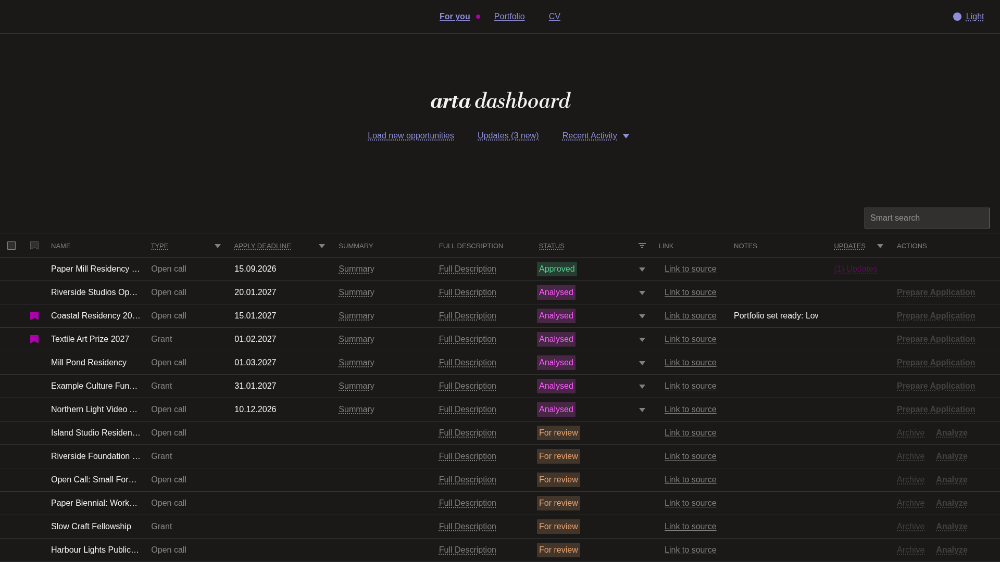
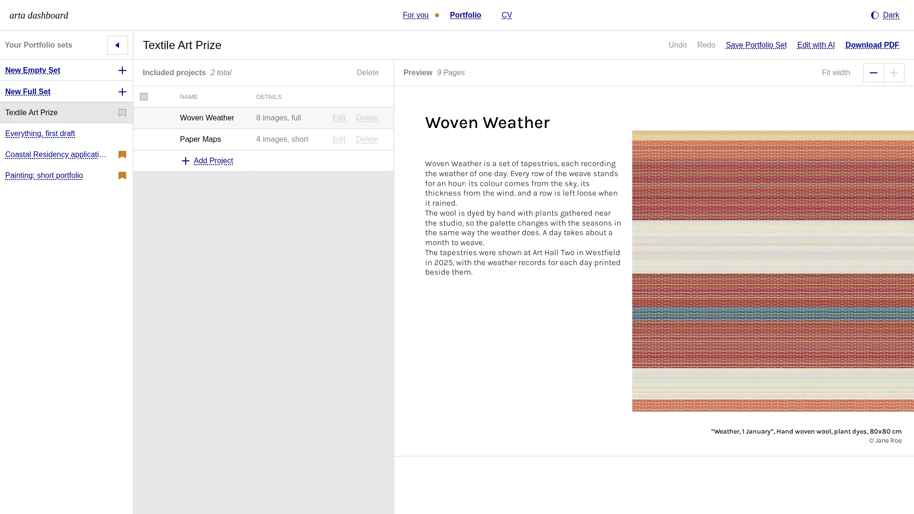
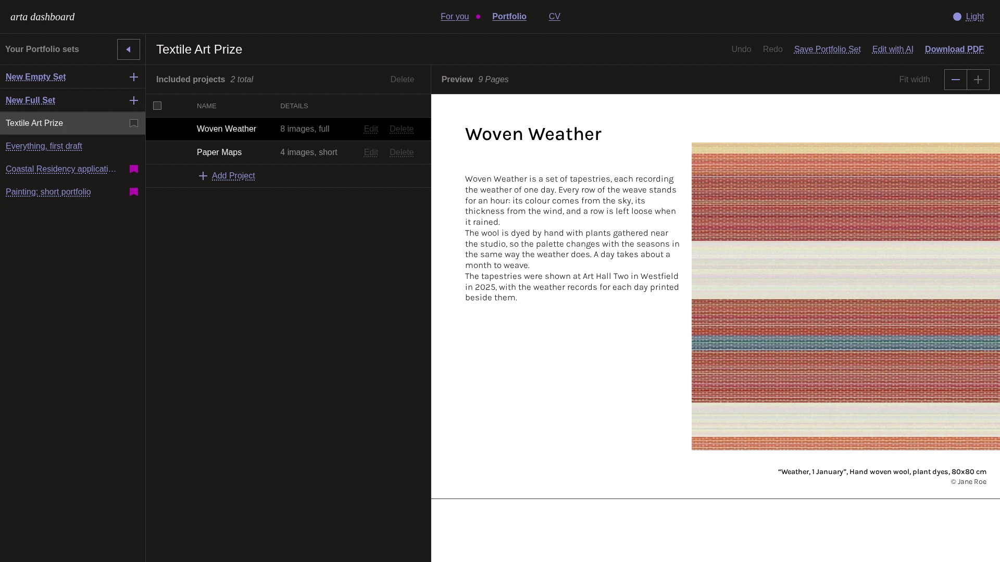
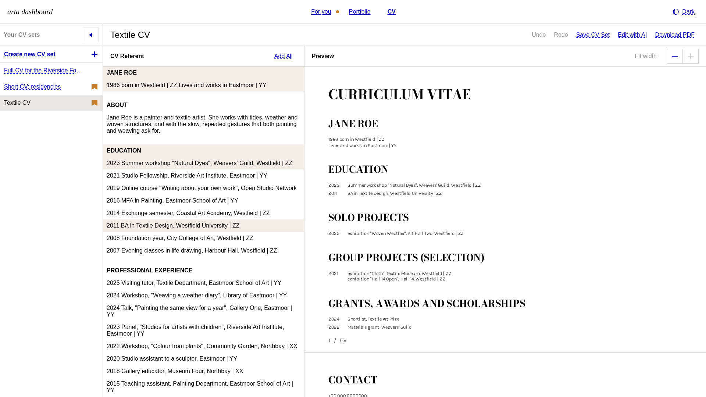
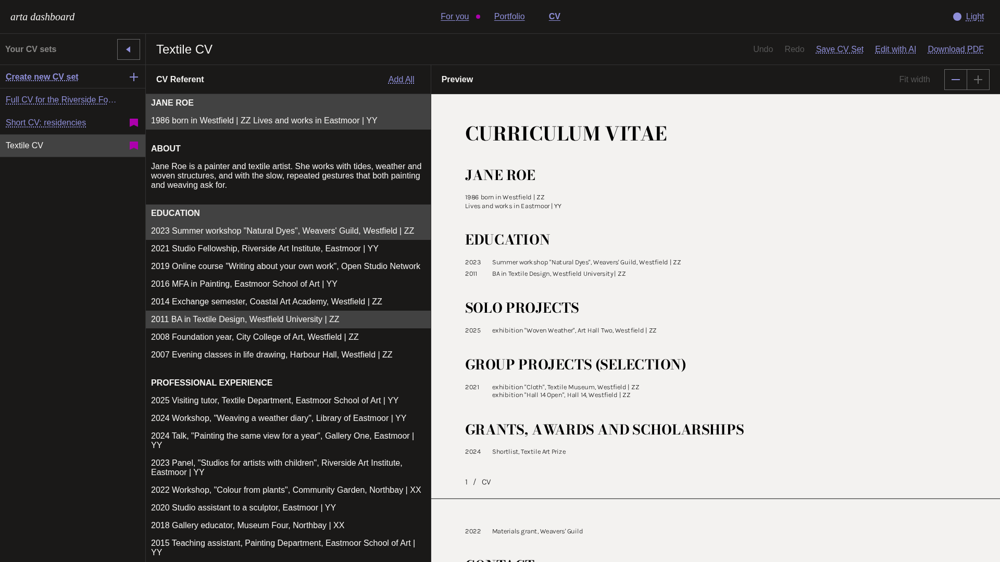

# arta

A local dashboard that helps an artist manage their practice: it collects open
calls and grants, analyses whether they fit, prepares a CV and a portfolio for
each application, and keeps track of applications and the replies to them.

arta finds, filters, analyses and prepares. It never submits anything: residency
and grant applications stay in the artist's hands.

- **For You**: incoming open calls and grants, analysed for eligibility and
  relevance, with deadlines; applied items and their replies.
- **Portfolio**: portfolio sets built from project folders, with a page preview
  and PDF export.
- **CV**: CV sets assembled from a master CV, with preview and PDF export.

| Light | Dark |
|---|---|
|  |  |
|  |  |
|  |  |

All screenshots show the made-up demo data (`python -m demo`).

## How it is built

- Python standard-library HTTP server and SQLite (Python 3.11 or newer for
  `tomllib`; tested on 3.13); vanilla HTML, CSS and JS.
- The design system is [dis-system](https://github.com/dsgnrfhmn/dis-system),
  included as a git submodule.
- Optional services: the Claude API for analysis and edits; one dedicated Google
  account (Gmail and Drive, read-only scopes) for intake and project files.
- Every external service has an offline stand-in: `mock` for the Claude API and
  `fixtures` for mail, projects and the CV. A fresh clone runs fully offline.

## Try the demo

```sh
git clone --recurse-submodules https://github.com/dsgnrfhmn/arta.git
cd arta
python3 -m venv venv && venv/bin/pip install -r requirements.txt
venv/bin/python -m demo
```

Open <http://127.0.0.1:8455/>. The demo runs on made-up data only: a fictional
artist, four projects whose pictures are drawn by code on the first start
(`demo/paint.py`), open calls in every state, CV and portfolio sets ready to
preview and export. It needs no configuration, no key and no network, and it
never reads `~/.config/arta`.

- Changes you make in the demo are kept between starts, in a folder outside the
  repository (`~/Library/Application Support/arta-demo` on macOS,
  `~/.local/share/arta-demo` elsewhere, or `--data-dir`).
- `python -m demo --reset` deletes that folder and starts again from the
  beginning. It only ever deletes a folder the demo made itself.
- `--port` picks another port; the default 8455 does not clash with arta's 8454.
- `python scripts/demo_screenshots.py` retakes the screenshots above into
  `docs/screenshots/`, from a fresh demo in headless Chromium.

## Run it

```sh
git clone --recurse-submodules https://github.com/dsgnrfhmn/arta.git
cd arta
python3 -m venv venv && venv/bin/pip install -r requirements.txt

mkdir -p ~/.config/arta && chmod 700 ~/.config/arta
cp config.example.toml ~/.config/arta/config.toml && chmod 600 ~/.config/arta/config.toml
# edit server.data_dir: an absolute path outside the repository

venv/bin/python -m web.server
```

Open <http://127.0.0.1:8454/>. The example configuration uses the fixtures and
the mock client, so nothing leaves the machine and nothing costs money.

On macOS, `scripts/install_macos.sh` installs arta as a per-user LaunchAgent that
starts at login; logs go to `~/Library/Logs/arta/`.

## Configuration

One TOML file outside the repository: `$ARTA_CONFIG`, or
`~/.config/arta/config.toml`. [`config.example.toml`](config.example.toml) lists
every setting with an example value and is the reference for all of them.

- Every key must be present. A missing or unknown key stops arta at start with a
  message that names it; there are no silent defaults.
- Secrets are never written into the configuration. It holds the paths of
  separate secret files (the Anthropic API key, the Google token), each mode 600
  and outside the repository. arta refuses a secret file that others can read.
- The database, caches and exports live in `server.data_dir`, which must be
  outside the repository.

### Where your content goes

Each kind of content names its own source, and nothing falls back to anything
else: `"none"` means not configured, and `"fixtures"` is the synthetic test data
in `tests/fixtures/`, never real content.

| Content | Source | Settings |
|---|---|---|
| Open calls (For You) | the dedicated account's Gmail inbox, the public ArtConnect listing | `[intake] sources = ["gmail", "artconnect"]` |
| Replies to applications | the same Gmail inbox | `[updates] source = "gmail"` |
| Portfolio projects | a folder on this machine, one folder per project (images, exhibition subfolders, a `.docx` description) | `[projects] source = "local"`, `local_dir` |
| | or a Drive folder shared to the dedicated account, optionally split into category subfolders | `source = "drive"`, `drive_folder`, `drive_categories` |
| Master CV | a file written by `scripts/build_cv_master.py` from a plain-text CV | `[cv] source = "local"`, `local_file` |
| | or a Google Doc shared to the dedicated account | `source = "drive"`, `drive_file` |
| Portfolio cover | a PDF on this machine or on Drive | `[portfolio_cover]` |
| Artist profile for analysis | a text file, mode 600 | `[llm] artist_profile_file` |
| Anthropic API key | a file holding only the key, mode 600 | `[llm] api_key_file` |
| Google access | `client_secret.json` from Google Cloud Console; `scripts/google_auth_setup.py` writes the token | `[google]` |

Personal files (the profile, the key, the token, the image-caption registry, a
local project folder or CV) must be outside the repository; arta refuses a path
inside it.

## Security model

- The server binds to `127.0.0.1` only. There is no setting to change that.
- Every request is checked in one place before routing: the `Host` header must
  name this server (against DNS rebinding), and every write must carry this
  server's `Origin` (against cross-site requests). No CORS headers are sent.
- Pages run under a strict Content-Security-Policy: no inline script, nothing
  loaded from other origins.
- Email bodies and web listings are untrusted input: sanitized, delimited as data
  in prompts, and never able to trigger an action.
- Google access uses read-only scopes; nothing in arta sends mail or writes to Drive.
- Live Claude API calls need an explicit `llm.mode = "live"`, a key file and a
  model name, and are capped per run by `llm.max_usd` and `llm.max_calls`.

## Contributing

Enable the pre-commit hook once per clone:

```sh
git config core.hooksPath .githooks
```

It runs [gitleaks](https://github.com/gitleaks/gitleaks) and a private denylist
(`~/.config/arta/denylist.txt`, one string per line) on every commit, and refuses
the commit if either is missing or finds something. CI runs gitleaks again on
every push.

Tests:

```sh
venv/bin/pip install pytest
venv/bin/python -m pytest
```

## License

MIT, see [LICENSE](LICENSE).
